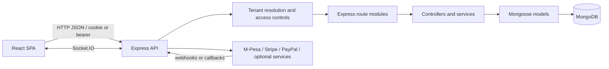

# Hussein Mboya Tours

A React and Express application for publishing tours and destinations, accepting reservations, and coordinating travel operations. The checked-in code has also grown into a tenant-aware platform with agent, staff, hospitality, finance, compliance, and platform-administration modules. The breadth of code should not be taken as proof that every module is production-enabled or externally certified; see the status notes below and the detailed readiness evidence in `docs/`.

## Problem and users

Tour operators need a shared place to present travel products, collect customer booking details, coordinate staff and transport, and follow payment status. This application implements public discovery and booking alongside role-oriented operational dashboards. Its intended users include travelers, tenant administrators, tour managers, agents, guides, drivers, and platform super administrators.

## Capabilities present in the code

- Public tour, destination, hotel, and airport-transfer discovery.
- Customer accounts, booking requests, booking management, and custom-tour requests.
- Staff and agent workflows, tour assignments, availability, and operational dashboards.
- Mongoose models with tenant scoping and tenant-aware request handling.
- M-Pesa STK Push initiation and callback/status processing; Stripe and PayPal integration code is also present.
- Hospitality reservations, payment, finance/accounting, reporting, compliance, and platform administration modules.
- Optional AI, email, messaging, file/media, and real-time capabilities when configured.

These are implementation capabilities, not a claim that all services have credentials, have passed external certification, or are active for every tenant. See [payments readiness](docs/PAYMENTS_AND_MPESA.md) and [implementation status](docs/PROJECT_OVERVIEW.md).

## Technology

| Area | Implementation |
| --- | --- |
| Browser application | React 19, React Router, Vite, TanStack Query |
| API | Node.js ES modules, Express 5 |
| Persistence | MongoDB via Mongoose 8 |
| Authentication | JWT, bcryptjs, HTTP-only cookie support and role/permission middleware |
| Payments | Daraja/M-Pesa, Stripe and PayPal code paths |
| Hosting configuration | Render API/static service in `render.yaml`; Vercel frontend build/rewrites in `vercel.json` |

## Architecture at a glance



## Quick start

Prerequisites: Node.js compatible with the installed dependencies, npm, and a MongoDB instance. The server loads `server/.env` (then root `.env`) and requires `MONGODB_URI` and `JWT_SECRET`.

```bash
cd server
npm ci
cp .env.example .env
# Set MONGODB_URI and JWT_SECRET in server/.env; configure exact CLIENT_ORIGINS.
npm run dev
```

In another terminal:

```bash
cd client
npm ci
# Set VITE_API_URL to the API origin/base expected by client/src/api/apiUrls.js.
npm run dev
```

More complete setup and variable references: [installation](docs/INSTALLATION.md), [environment variables](docs/ENVIRONMENT_VARIABLES.md).

## Development commands

Run from the relevant directory:

| Command | Purpose |
| --- | --- |
| `cd server && npm test` | Node built-in test runner for `server/tests/*.js` |
| `cd server && npm run check:all` | Syntax/contract/readiness checks, including a production readiness script |
| `cd client && npm run lint` | ESLint over client files |
| `cd client && npm run build` | Vite production build |
| `cd client && npm run test:e2e` | Playwright end-to-end tests |

These commands can depend on environment variables, a database, or external services. Consult [testing](docs/TESTING.md) before treating a result as a live integration test.

## Screenshots

Screenshots are not included in this repository snapshot. Add current, non-sensitive screenshots here when available.

## Deployment

`render.yaml` defines a Render Node web service rooted at `server/` and a Render static frontend rooted at `client/`. `vercel.json` separately defines the Vite frontend build and SPA fallback. Configuration in a manifest does not prove that a service is currently deployed or healthy. See [deployment](docs/DEPLOYMENT.md) and repository readiness evidence.

## Documentation

Start at **[docs/INDEX.md](docs/INDEX.md)**. It links the architecture, source guides, all 629 mounted API inventory entries, database models, security/payments, workflows, deployment and interview material. Thirty-three alias-inclusive API entries now have source-traced contracts; the remaining 596 are explicitly partial. The source review registry lists 16 scoped critical-module reviews, not exhaustive file reviews.

Check documentation coverage after source or route changes:

```bash
node scripts/check-documentation-coverage.js
```

The audit reports indexed, structural, deep-linked and fully reviewed source counts separately; it also verifies model pages, endpoint guide entries, local links and selected secret patterns. A passing structural audit does not mean all endpoint contracts or all source behavior are deeply explained.

## Limitations and status

- This is a broad, actively evolving codebase. The route and module surface is large; inspect authorization and tenant scope for the specific operation you discuss.
- Presence of a payment provider adapter does not establish a successful end-to-end provider payment. The repository's readiness notes document missing or unverified credential, callback, sandbox, and production evidence.
- `render.yaml` and `vercel.json` are deployment definitions, not deployment evidence.
- Automated tests cover selected behavior; they do not establish production security, financial reconciliation, or provider certification.
- Some optional modules require external credentials and may be unavailable without them.

## Maintainer

The repository is published at [`isaacokubi/hussein-mboya-tours`](https://github.com/isaacokubi/hussein-mboya-tours), and recent Git commits use the `isaacokubi` author identity. This README avoids adding personal biography or employment claims that are not established by repository evidence.
