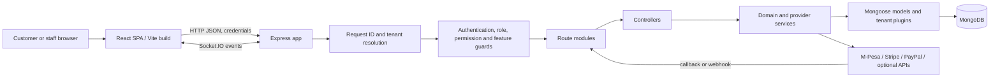
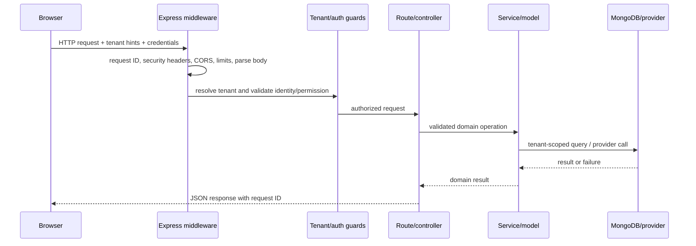
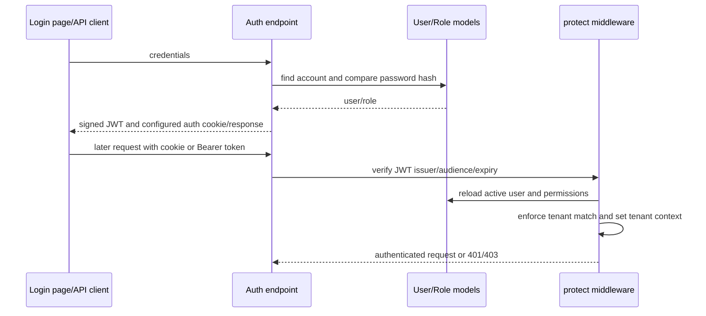
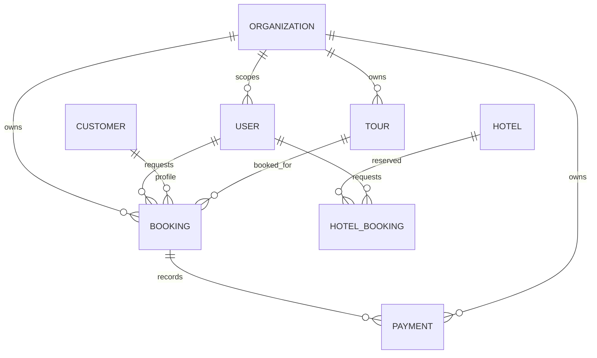

# Architecture

## System shape

The project is a browser SPA plus a JSON API. The frontend is React 19 with React Router, Vite, TanStack Query and Axios. The backend is an Express 5 ES-module application on Node.js. Mongoose maps domain documents into MongoDB. External providers are accessed from backend services/controllers; callback routes return provider results into the backend.



## Startup and request lifecycle

`server/server.js` loads tenancy and accounting hooks, creates the HTTP and Socket.IO servers, starts listening, then retries database startup. Critical startup includes Mongo connection, optional staging seed, and invoice index migration. After readiness it starts background schedulers/workers. `server/app.js` installs request context, Helmet, rate limiting, CORS, compression, JSON/form/cookie parsing and request logging; it resolves tenant context before the API router. Database readiness gates normal API calls. 404 and final error handlers terminate unmatched/error flows.



## Tenant/data architecture

`Organization` represents a tenant. A tenant may be resolved using host/domain or request headers according to `tenantMiddleware.js`; authenticated users are checked against their tenant, while super-admin access is explicitly platform-scoped. `server/tenancy/` contains AsyncLocalStorage context, query helpers, bootstrap and plugins. Models commonly install `tenantPlugin`; controllers also use `mergeTenantFilter`/`requireTenantId`. This layered approach is intended to reduce cross-tenant reads/writes. Verify each sensitive path: a plugin cannot replace authorization review, especially for aggregation/raw queries and background tasks.

## Frontend architecture

`client/src/main.jsx` creates the React root and shared providers; `App.jsx` composes site chrome and application routes. `routes/AppRoutes.jsx` lazy-loads pages and groups role dashboards behind route guards. `context/` contains authentication, cart, settings, tenant and notification context. `api/` provides Axios-based endpoint modules; TanStack Query is used for asynchronous server state and cache invalidation. Components are organized by domain and dashboard role.

## Backend architecture and patterns

The server follows an Express route → controller → service/model layering, with some controllers also containing domain rules. Mongoose schemas hold persistence validation, indexes, methods, hooks, and tenant plugins. Middleware composes cross-cutting concerns (auth, tenant resolution, permission checks, validation, rate limits, audit, upload). Services centralize reusable payment, lifecycle, accounting, and provider operations. Background schedulers use explicit startup/stop logic in the server entry point.

Observed patterns include middleware pipelines, service modules, repository-like Mongoose models, dependency injection of an Axios client in M-Pesa functions for testability, and transaction use for atomic booking/slot creation. Do not describe the whole backend as strict MVC: responsibilities are distributed and some controllers are substantial.

## Authentication sequence



Exact cookie attributes and token issuance details vary by auth controller; consult `authController.js`, `utils/authCookie.js`, and `middleware/authMiddleware.js` before presenting the sequence as a precise response contract.

## Booking and payment sequence

```mermaid
sequenceDiagram
  participant C as Customer SPA
  participant API as Express booking/payment routes
  participant DB as MongoDB
  participant M as M-Pesa Daraja
  C->>API: create booking (authenticated)
  API->>DB: validate tour/custom quote and reserve capacity
  API->>DB: create booking in transaction where configured
  DB-->>C: booking details
  C->>API: initiate STK Push with booking and phone
  API->>DB: authorize booking access; create payment attempt
  API->>M: authenticated STK request
  M-->>API: accepted request + checkout identifiers
  M->>API: asynchronous callback
  API->>M: query/verify provider result as implemented
  API->>DB: update payment and booking lifecycle
  C->>API: poll status/retrieve booking
  API-->>C: current persisted status
```

This diagram is conceptual: provider callback and verification behavior is implemented across several modules and must be read with `PAYMENTS_AND_MPESA.md`. An accepted STK request is not proof of payment.

## Database relationship sketch



Relationships are ObjectId references, not SQL foreign keys. The diagram is intentionally a high-level subset; see [database inventory](DATABASE.md).

## External boundaries and deployment

Provider API calls, email, SMS/WhatsApp, media hosting, AI, and database are external boundaries. `render.yaml` configures Render API/static services; `vercel.json` configures a Vite static frontend independently. These manifests do not prove which host is currently serving production. See [deployment](DEPLOYMENT.md).
