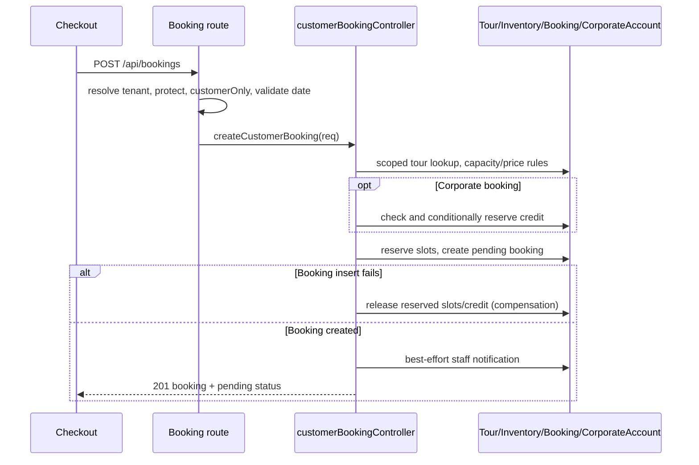

# Business logic and workflows

This guide describes code paths that are present in the repository. A feature being implemented does not prove it is enabled for every tenant or successfully operating in production. Sources and contract limits are called out in each workflow.

## 1. Customer registration and login

**Problem/actors:** A traveler needs an account scoped to a tour operator. The tenant customer submits registration or credentials; the company domain/header selects tenant context.

**Registration:** `AuthContext.register` posts `/auth/register`. `authRoutes.js` runs `resolveTenant`, then `authController.register` validates name/email/10-digit phone/password, requires a tenant, checks duplicate email/phone inside that tenant, creates a customer `User`, and returns a public user projection. It sets `isVerified: true` in code without a separate contact-verification step. It returns no token, so frontend registration does not automatically sign the session in.

**Login:** React `AuthContext.login` clears old user/tenant state and query cache, posts email/password, and expects token/user (or MFA challenge). The server resolves tenant, rate-limits login, finds a tenant-scoped account (or a tenantless platform role), checks status/lock/password, and issues JWT + auth cookie. The user model hashes changed passwords with bcryptjs. Protected API requests then verify token and reload user/permissions.

```mermaid
sequenceDiagram
  participant UI as Login UI/AuthContext
  participant API as Express auth route
  participant Tenant as Tenant resolver
  participant DB as User/Role/SecurityLog
  UI->>API: POST /api/auth/login (email,password)
  API->>Tenant: resolve request tenant
  API->>DB: tenant/platform account lookup
  DB-->>API: user + role/permissions
  API->>DB: matchPassword, update attempts/lastLogin, audit
  API-->>UI: token + public user, set HttpOnly cookie
  UI->>UI: persist UI session; preload tenant settings
  UI->>API: GET /api/auth/me on restore
  API-->>UI: current user state
```

**Failure/recovery:** missing fields (400), invalid credentials (401), inactive account (403), locked account (423), ambiguous local email across tenants (409), or MFA challenge. Reset uses a hashed six-digit code, 10-minute expiry, and attempt cap; mail failure clears the code. See [auth controller explanation](code-explanations/backend/auth-controller.md) and [API contract](API_VERIFIED_CONTRACTS.md#post-apiauthlogin).

## 2. Tour discovery and selection

Public pages call tour/destination/package API modules. `tourRoutes.js` contains list, featured, search, slug, detail and availability reads; controller/service/model filters determine publication, deletion, tenant and query constraints. The UI can filter/sort/display records, but the server remains responsible for public visibility. Booking checkout may prefill date/location from a selected tour. Public catalog browsing does not reserve inventory.

**Sources:** `client/src/pages/` tour/public pages, `client/src/api/tourApi.js`, `server/routes/tourRoutes.js`, tour controllers/services, `server/models/Tour.js`.

## 3. Customer booking creation and availability

**Problem/actors:** An authenticated customer requests a place on a tenant-owned tour for a date. The customer page sends intent; server calculates price and capacity.

**Request path:** Checkout → `bookingApi.createBooking` → `POST /api/bookings` → router `resolveTenant`, `protect`, customer role, `validateBookingTravelDate` → `createCustomerBooking`.

**Rules/data:** The controller requires `tour` and `travelDate`, requires tenant payment method availability, normalizes booking type, loads a non-deleted tenant-scoped Tour, derives guests with a minimum of one, applies group minimum, checks capacity, and calculates amounts from server-side tour/pricing data. Corporate bookings separately reserve account credit after rechecking the limit in a conditional update. It creates a pending `Booking` with user/tour refs, snapshots, travel fields, totals, balance and payment status; then notifies staff best-effort.

**Important transaction boundary:** `createCustomerBookingWithReservations` reserves capacity, then conditionally claims corporate credit, then creates the booking. It compensates capacity and claimed credit when later operations fail; compensation errors are logged and the original error is retained. Focused tests cover slot failure (credit untouched), credit update failure, booking insertion failure, compensation failure and success. This fixes the previously documented ordering gap where credit was increased before capacity reservation. It remains compensation, not a Mongo transaction: process termination between operations, ambiguous write outcomes, failed compensation, and duplicate requests without idempotency can still leave inconsistent state. The controller does not call the separate Mongo transaction helper in `bookingCreationService.js`.



**Errors/recovery:** 400 missing tour/date, invalid booking type, undersized group or missing corporate requirements; 404 tenant-scoped tour missing; 409 disabled method/capacity/pricing/credit conflict. A compensation failure is logged and needs operational review. In addition, a thrown slot reservation occurs before the compensation block, so corporate credit reserved earlier may not be rolled back. Full details: [customer booking explanation](code-explanations/backend/customer-booking-controller.md), [booking workflow walkthrough](CORE_CODE_WALKTHROUGHS.md#2-customer-booking-creation-and-capacity).

## 4. Custom-tour request, quote and conversion

This is a separate workflow from `POST /api/bookings`. A request can be submitted with optional login (`optionalProtect` in the route); guest requests require name/email. Tenant staff can quote/approve/reject and assign guide/driver/agent resources. A quote must be positive except for rejection. Converted/rejected requests cannot be re-quoted or assigned.

On customer conversion, the controller requires the request to belong to the current user and be quoted/approved. It reuses a linked booking if one exists, otherwise finds or creates a hidden “Custom Tour Package” Tour/Destination and creates a Booking with `customTourRequest`, snapshot and server-held quoted amount, then marks request converted. This path uses custom snapshot data; it is not the same handler as customer tour booking and should be discussed separately.

**Sources:** `server/routes/customTourRequestRoutes.js`, `server/controllers/customTourRequestController.js`, `CustomTourRequest`, `Booking`, `Tour`, `Destination` models.

## 5. Checkout and payment initiation

The Checkout UI loads server booking/tour/settings through TanStack Query, stores draft fields locally, and computes display balance/deposit bounds. Those calculations are UX only. A booking is created before the selected payment mutation; if payment initiation fails, the booking is not rolled back by the frontend.

M-Pesa initiation requires authenticated tenant access, valid booking ownership, enabled method, outstanding amount, Kenyan phone, and no conflicting pending attempt. Server derives payable amount from the stored booking; it persists a Payment attempt and submits Daraja STK. A provider HTTP success means request accepted/IDs returned, not money settled. Stripe/PayPal redirect flows and bank/cash pending staff confirmation are separate code paths.

**Failure handling:** a known M-Pesa provider rejection marks attempt failed; a network timeout can be uncertain and the controller blocks blind retry when there is no checkout ID. Frontend polls backend status up to 60 times at 3-second intervals; UI timeout does not imply provider failure.

## 6. M-Pesa callback and payment confirmation

Daraja calls the callback without a user JWT. Route middleware validates callback shape, resolves tenant from stored checkout ID, independently queries Daraja using the attempt's environment, and compares provider/callback classification. The controller is `subscriptionMpesaCallback`: a matching SubscriptionPayment follows subscription activation; otherwise the controller delegates to booking/hospitality `mpesaCallback`.

The booking callback checks attempt/booking, classifies provider result, amount and receipt, and calls `failBookingPayment` or `completeBookingPayment`. Completion updates payment and booking in a Mongo session transaction and may create accounting/commission/email side effects. Terminal attempts are ignored by the controller. The lifecycle helper's own idempotency predicate is narrower for partial payments; preserve the controller terminal guard and test alternate callers/replays.

The callback controller catches processing errors and returns Daraja's accepted result code. That stops callback retry loops, but can acknowledge an internal failure; logs, alerts and reconciliation are necessary to detect stuck payments. A provider callback acknowledgment is not equivalent to a verified payment record.

```mermaid
sequenceDiagram
  participant UI as Checkout
  participant API as M-Pesa initiation API
  participant Daraja as Daraja API
  participant DB as Payment/Booking
  participant Callback as Callback route
  UI->>API: POST /api/mpesa/stkpush
  API->>DB: verify booking/amount; create processing Payment
  API->>Daraja: OAuth + STK Push
  Daraja-->>API: accepted + checkout IDs
  API->>DB: save IDs, pending Payment/Booking
  API-->>UI: pending status + checkoutRequestID
  Daraja->>Callback: STK callback
  Callback->>DB: resolve attempt/tenant
  Callback->>Daraja: independent STK query
  Daraja-->>Callback: provider state
  Callback->>DB: complete/fail payment lifecycle
  UI->>API: GET status/:checkoutRequestId
  API-->>UI: persisted status
```

**Sources:** `mpesaRoutes.js`, `resolveMpesaCallbackTenant.js`, `mpesaCallbackIntegrity.js`, `subscriptionMpesaCallbackController.js`, `mpesaController.js`, `paymentLifecycleService.js`. See [payment callback walkthrough](CORE_CODE_WALKTHROUGHS.md#3-payment-attempts-and-m-pesa-callback-trust) and [payment contracts](API_VERIFIED_CONTRACTS.md).

## 7. Tenant subscription billing

The tenant subscription router is separately mounted at `/api/subscription` before the general `/api` router. It requires `protect` then tenant resolution. An admin can read tenant plan/subscription/payment history; only an admin can initiate M-Pesa subscription payment. The controller loads platform-configured price, and the service validates plan/configuration, creates `SubscriptionPayment`, requests an STK prompt, and saves provider IDs. This subscription initiation uses legacy/platform M-Pesa configuration rather than the tenant payment-gateway flow.

Callback middleware validates and provider-queries the checkout. `subscriptionMpesaCallbackController` matches subscription attempt, checks amount and receipt, persists result, then calls `activateTenantSubscription`. Scheduler code expires/graces subscriptions and may suspend organizations. Do not conflate tenant subscription billing with a customer booking payment.

**Sources:** `server/app.js`, `tenantSubscriptionRoutes.js`, `tenantSubscriptionController.js`, `tenantSubscriptionService.js`, `Subscription` and `SubscriptionPayment` models.

## 8. Booking management, customer and staff operations

Staff booking list/detail/status/assignment routes use role/permission middleware and tenant-filtered controllers. Admin status transitions may require full payment (`requireFullPaymentForTrip`). Cancellation/reschedule/travel-date updates have separate validation and side effects; inspect their actual controllers before claiming refunds or inventory release occur automatically. Customer dashboards query the authenticated user's bookings. Customer CRM and admin customer-management routes use their own controllers/models; they are not just views of the `User` record.

Tour managers/admins update tours, assignments, vehicles and staff. Guides/drivers receive role-scoped work views. Route and controller guards enforce action/resource boundaries; model refs represent assignments. Exact transitions and side effects are feature-specific.

## 9. Hospitality and other operations

Hotels, rooms, airport transfers and hospitality bookings use distinct schemas and lifecycle/payment controllers rather than the main tour `Booking` schema. Operations, finance, tax, compliance, CRM, content management and reporting modules implement staff workflows through their route/controller/model layers. Provider availability and tenant feature settings can disable paths.

## Known workflow limits

- Source presence is not proof that every feature is enabled/configured in a tenant.
- No live payment or production state is inferred from code. See dated readiness evidence.
- Reservation compensation can fail after partial writes; payment callbacks can be acknowledged despite internal errors. Reconciliation/monitoring and robust recovery tests are important follow-ups.
- Route coverage is broad, but only 33 mounted API entries currently have full hand-traced contracts; see [API endpoint guide status](API_ENDPOINT_GUIDE/INDEX.md).
