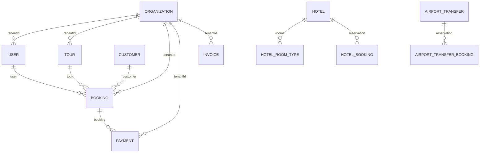

# Database

## Technology and schema model

The application uses MongoDB and Mongoose. Documents, nested subdocuments, ObjectId references, indexes, validation, timestamps, virtuals, statics, hooks and tenant plugins are defined in `server/models/*.js`. Relationships are application-level references; MongoDB does not enforce relational foreign keys. Most tenant-owned records carry `tenantId` referencing `Organization` and use a tenant plugin or explicit tenant filter.

## Core model relationships

This is a conceptual subset; individual schemas may use nullable references or embedded snapshots. Check schema definitions for exact cardinality and requiredness.

## Complete model inventory

All **96 model files** now have a dedicated schema explanation in the [model index](code-explanations/database/models/INDEX.md). The pages were generated by importing and compiling every Mongoose model with placeholder test environment variables and no database connection. They report compiled field paths, types, required status, defaults, enum/range/length/custom validators, references, options, indexes, timestamps, detected methods/virtuals/hooks and static caller references.

Field-purpose prose is explicitly inferred from the field name/schema; it is not a substitute for the application rule. Each page links the model source and likely callers so the lifecycle can be checked. Mixed fields can contain dynamic subkeys, and Mongoose introspection cannot prove out-of-band MongoDB indexes or behavior of all controller workflows. Confirm those in source and the actual deployment before changing data contracts.

The model domains include identity/tenancy, tours and bookings, hospitality, payment, accounting/tax, operations, compliance, messaging, integrations, and audit/AI support. Use the [model explanation index](code-explanations/database/models/INDEX.md) for the complete list and per-model field tables.

## Constraints, indexes and lifecycle

Mongoose schema validators enforce required fields, enums, ranges and nested shapes. Schemas define query indexes for common lookups, tenant scope, status/date filtering, unique booking references and webhook/provider identities. Some indexes are partial/unique. `server.js` runs invoice index migration during startup, and scripts include tenant index reconciliation and other data repair tools. Seeds and migrations are not interchangeable: review their guard flags and target database before executing.

Booking creation can run capacity reservation and document creation in a MongoDB session transaction (`services/bookingCreationService.js`). Other operations may use atomic updates or lifecycle services. A schema hook can enqueue webhook/payment ledger side effects; external side effects and Mongo transaction commit boundaries deserve care.

## Backup and production data

The repository contains operational backup/readiness documentation and platform maintenance code, but a configured backup feature does not establish that production backups or restores have been verified. See dated evidence and [deployment](DEPLOYMENT.md). Never run destructive seed/repair scripts against production without reviewing their explicit safeguards.
