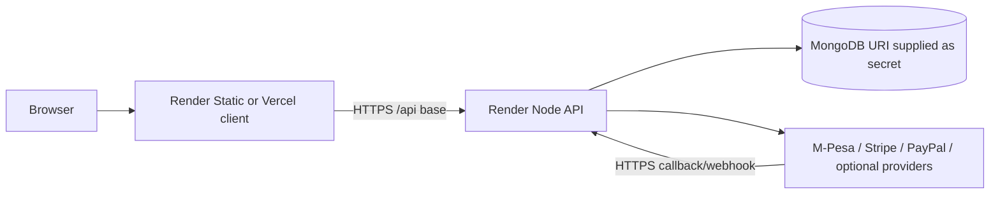

# Deployment

## Configuration found in repository

`render.yaml` defines two Render services: a Node web service rooted at `server/`, installed with `npm ci`, started by `npm start`, with `/api/health` as health check; and a static client rooted at `client/`, built with `npm ci && npm run build`, publishing `dist` and rewriting paths to `index.html`. It declares numerous environment keys with secret values supplied out of band.

`vercel.json` independently defines a Vite client build from `client`, static output at `client/dist`, SPA rewrite and no-cache headers for HTML/service worker. The manifests show potential deployment targets, not which one is active or whether a current build is healthy. Render's single manifest does not define MongoDB hosting; the server expects an external MongoDB URI.

## Production topology (configured shape)

## Release considerations

Provide production HTTPS API/client origins, an optional `PLATFORM_HOST` only after registering a domain, strong JWT and encryption secrets, intended MongoDB URI/database, provider callback routes, and optional integration secrets through host secret settings. Do not commit `.env`. Frontend `VITE_*` variables are build-time public values. Render health check is readiness-based, so the API may be marked unhealthy until DB/startup migration is ready.

## Operations and rollback

The source contains readiness endpoints, request logging, scheduled workers, database index migration and some admin backup/maintenance capability. It does not establish external log aggregation, alerting, verified production backup/restore, or a tested rollback procedure. Existing production runbooks and readiness reports are the evidence to consult. A rollback strategy should include compatible frontend/API versions, database schema/index compatibility and safe restore criteria; no automatic rollback mechanism is asserted here.

## Verify before stating deployed status

Confirm the actual hosting project/service identifiers, deployed commit, environment values, API health, frontend origin/CORS, MongoDB access, log visibility, payment callback reachability and backup/restore evidence using authorized deployment access. No live host verification is claimed by this document.
